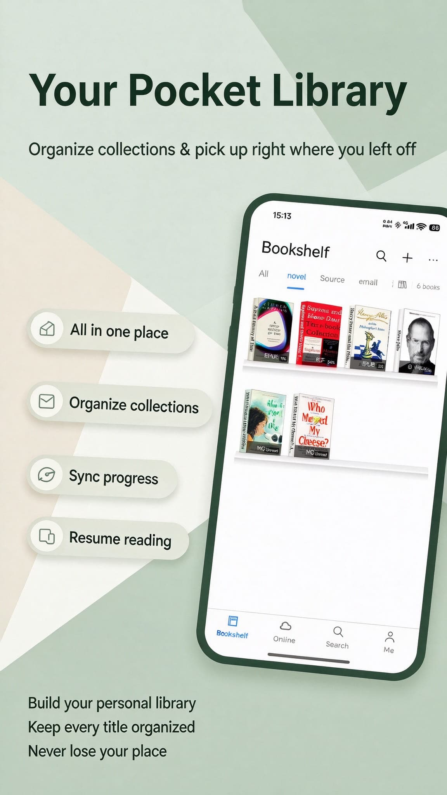
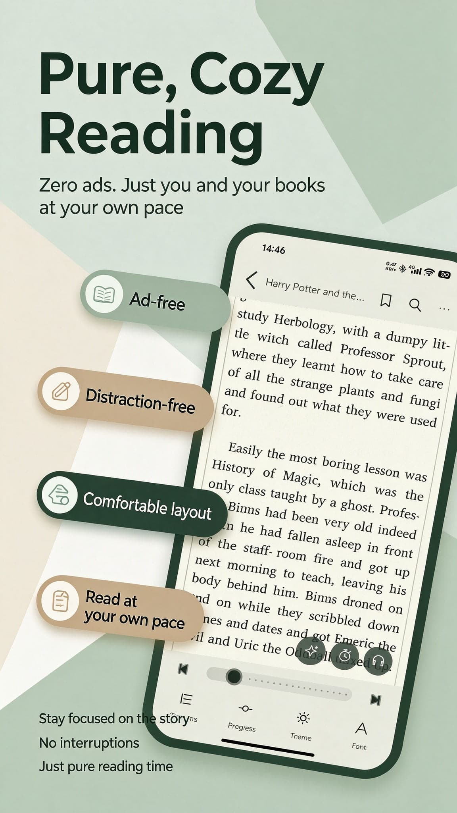
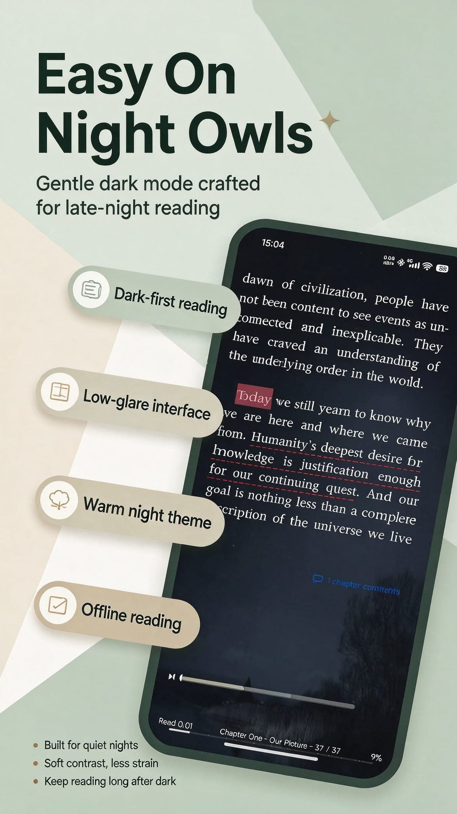
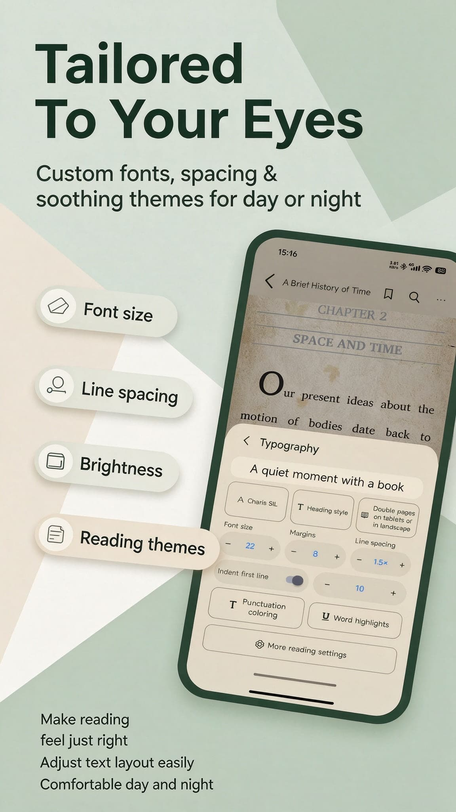

  

# Sloth Reader

### Make room for a good book.

Your books, your thoughts, your own pace. 
A calm, local-first reader for Android.

[Get it on Google Play](https://play.google.com/store/apps/details?id=io.hui.slothreader) · [Visit the website](https://liuyueyi.github.io/SlothReader/) · [Releases & source](https://github.com/liuyueyi/SlothReader/releases)

---

## A reading space that feels like yours

Bring your own books and find a comfortable way to read. Sloth Reader puts your library, reading settings and notes together in one place, with room to make every page your own.

- **Your books, together.** Browse local books and files, and organise your collection on a personal bookshelf.
- **Read your way.** Adjust fonts, margins, line spacing, colours, backgrounds and page-turning modes.
- **Keep your place.** Return to your reading progress, bookmarks, highlights and notes.
- **Listen and explore.** Use text-to-speech, OPDS catalogues and the cloud or sync features available in your edition.
- **A home for many formats.** Read PDF, EPUB, MOBI, TXT, FB2, DjVu, CBZ and other supported formats.

## A closer look

  
  
  
  
  

## Downloads and source

Install Sloth Reader from [Google Play](https://play.google.com/store/apps/details?id=io.hui.slothreader), or visit [GitHub Releases](https://github.com/liuyueyi/SlothReader/releases) for published Android packages and the corresponding source packages. Choose the source package that matches your installed version.

Sloth Reader is distributed under the [GNU General Public License, version 3 or later](https://www.gnu.org/licenses/gpl-3.0.html). Third-party components are subject to their respective licences.

[Privacy policy](SlothReaderPrivacyPolicy.html) · [Terms](terms.html) · [Contact](mailto:yihuihui@gmail.com)
